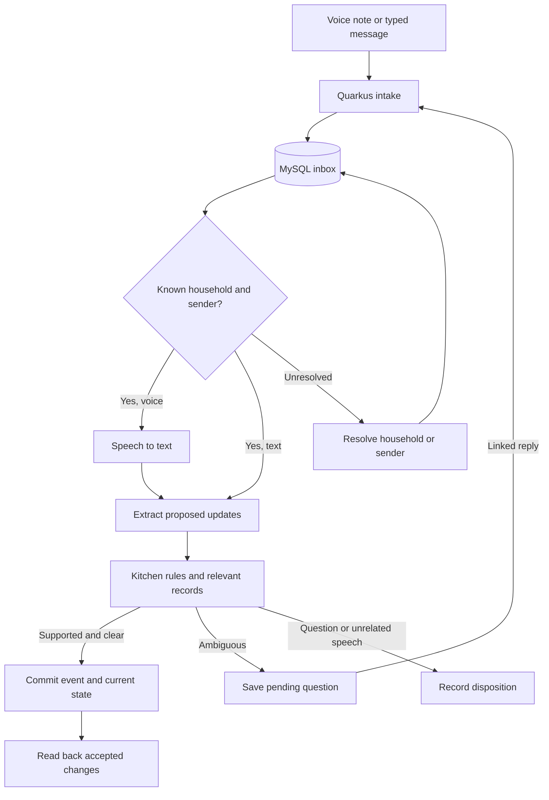

# Voice notes to household records

Proposed architecture for the first Kivi feature. A cook sends a voice note, Kivi records each supported kitchen update in MySQL, and an authorised household member can see what was recorded, who reported it and what correction followed. The first demonstration ends at read-back. Purchasing is a separate future use of the data.

## Layout

Intake, processing, rules and reads run in one Quarkus deployment. The inbox and all durable workflow and kitchen records share one MySQL instance. The application module owns transport, media, speech, model calls and transactions. The kitchen module owns the vocabulary, validation and state transitions as plain Java. Start with an authenticated audio upload and a text test input. WhatsApp later supplies the same message envelope plus its media reference and reply ID. Use one speech provider and one extraction provider behind small Java interfaces. Either can change independently.

## From receipt to commit

1. **Receive.** Validate the channel request. Derive actor and household from authenticated membership and conversation binding. Someone working in two homes may need to choose one. Attribute shared or forwarded audio to the submitting account and preserve speaker uncertainty. Capture source ID, reply ID, sent time, receipt time and media reference. A unique channel/account/message key deduplicates deliveries. Acknowledge receipt after durable intake. For direct uploads use private temporary storage and a client retry key. For channel media, persist the reference and fetch promptly. Mark expired or unreadable media for resend.
2. **Transcribe.** A worker in the same process claims an inbox row with an expiring lease. Make external calls outside SQL transactions. Persist the original-language transcript, attempt ID and recogniser version. Preserve mixed speech and the words actually heard. Keep audio segment offsets when available. Unsupported, silent or unintelligible notes get a retry or a request to repeat. Treat audio as private temporary input with an explicit expiry. Confirm the retention period and permitted listeners before a household pilot.
3. **Interpret.** Supply the transcript, household time zone, sent time, reply target and only the relevant household context. Return a bounded list of typed proposals. Each carries an operation, item, quantity and unit if stated, effective time or condition if stated, evidence words and the target of any correction. Allow unknown values. Preserve approximate units such as “half a dabba”. Treat self-corrections and negation across the entire note before committing any clause. An extraction attempt records transcript, model, prompt and output-schema versions. A typed transcript can exercise this step independently.
4. **Decide.** Java checks operation type, evidence, references, membership, role and expected state version. Resolve item aliases within the household. Keep purchase quantity and desired stock as distinct intents. A question, an observation and a request have different effects. Conflicting observations can coexist with their observation times. Leave disputed current quantity unresolved if the evidence cannot order them. For an ambiguous clause, store a pending proposal and one focused question. Independent clear clauses can proceed. Hold dependent clauses together.
5. **Commit.** Write accepted domain events, affected current-state rows, proposal dispositions and any clarification or acknowledgement due in one MySQL transaction. Scope reads and writes by household. Give each accepted operation a unique source-message and clause identity tied to the chosen interpretation. A retry resumes that interpretation. Competing workers must verify the active attempt at commit. On a version mismatch reload the relevant state and revalidate. Corrections append a linked event and update the current view. Re-running extraction with a new model creates a reviewable attempt and requires explicit reconciliation before changing accepted state.
6. **Read back.** Return what was recorded and what still needs an answer. A channel reply worker can deliver the stored acknowledgement after commit and retry it independently. A reply references the pending question and triggers the same intake path. A household-scoped query can retrieve the current value, uncertainty, event chain and retained evidence. Preserve the distinction between when something happened, when it was reported and when Kivi committed it.

## Worked example

At 7:40 the cook says “Fridge mein chaar ande hain. Kal ke liye chhe aur mangwa do. Doodh bhi… nahi, doodh rehne do.” Assume the sender is bound to this home and may report stock and make requests.

| Evidence | Accepted kitchen record | Current view |
| --- | --- | --- |
| “chaar ande hain” | Cook observed 4 eggs in the fridge at the time of the note | Last reported egg stock is 4 |
| “kal ke liye chhe aur” | Cook requested 6 additional eggs for tomorrow, resolved using the household date | Open egg request is 6 |
| “doodh bhi… nahi” | Interpretation records a withdrawn clause | No new milk request. An unrelated existing milk request survives |

At 8:05 the cook replies “Sorry, do aur, chhe nahi.” With a unique reference to the egg request, append a correction from 6 to 2. The stock observation stays at 4. The read-back is “Four eggs reported in the fridge. Two more requested for tomorrow.” The request history shows both quantities. If “do aur” could reasonably refer to another line, ask which item before changing either.

## Logical storage responsibilities

These are record responsibilities for review. Physical tables, keys and migrations come with data modelling.

| Record | What it must answer |
| --- | --- |
| Source message and media reference | Which household account sent this, when, through which channel, and is its evidence still retained? |
| Transcript and interpretation attempt | What text did Kivi hear, what version interpreted it, and which words support each proposal? |
| Proposal and disposition | Which clauses were accepted, withdrawn, deferred or unsupported? Which reply resolved the question? |
| Kitchen event | Who reported or corrected what, for which item, effective when, and which source and prior event explain it? |
| Current kitchen state | What is the latest supported observation or open request, with what uncertainty and revision? |
| Processing and reply status | Which stage completed, what can be retried, and does a response still need delivery? |

The audit trail explains what Kivi understood. Audio expiry limits later verification of what was spoken. A fluent transcript can still hear “six” as “ten”. Evidence spans and schema validation alone will accept that error. During the pilot, show quantities, units and negations in the read-back and measure how often people correct them. Where the system detects conflicting alternatives on a material detail, ask directly.

## Failure cases to rehearse

| Situation | Intended outcome |
| --- | --- |
| Telugu or Kannada item names inside English or Hindi, background TV, overlapping speakers | Preserve original terms. Ask for the uncertain item or quantity. Multiple voices do not establish separate identities. |
| “If guests come, get paneer”; “How much milk is left?” | Keep the condition pending. A stock question reads existing state. Neither creates an unconditional purchase request. |
| “Two packets” with unknown packet size; “some batter left” | Preserve the reported unit or approximation. Do not invent grams or a precise stock count. |
| Child asks for ice cream; two adults disagree about cancelling milk | Apply the household’s configured permissions. Link the competing instructions and defer an unresolved override. |
| Old note arrives after a newer observation; “tomorrow” crosses midnight during processing | Resolve relative dates using the original sent time and household zone. Track receipt separately. Avoid silently replacing a newer observation. |
| Webhook repeats; cook independently repeats the same words | Deduplicate identical delivery IDs. A new message is new evidence. Ask whether it adds to an existing request if that matters. |
| Speech or model timeout, invalid structured output, crash after commit | Resume the failed stage, use bounded retries, record terminal failure. A committed event remains unique even if its acknowledgement must be resent. |
| New model gives a different answer to an old recording | Keep both attempts and the original decision. A correction explicitly links the change. |
| “Cancel that” after two pending requests; two distinct clauses share an uncertain unit | Ask for the target or unit. Independent accepted records survive clarification and replay. |

## First vertical slice and evidence

1. Submit a short recording through local authenticated upload. Demonstrate a stock observation and a grocery request end to end, including actual MySQL writes and a read-back by message ID.
2. Add correction and clarification, duplicate delivery and restart tests. Check the event history, resulting current values and absence of unintended changes. Exercise the same clip with a deliberately late arrival.
3. Build paired fixtures with consented or synthetic speech, a human-verified transcript and expected records. Compare audio-to-record with verified-text-to-record. Inspect speech errors at item, quantity, unit and negation level. Track wrong accepted updates, missing updates, clarification frequency, correction frequency, latency and tokens per accepted update. Keep household data outside Git.
4. Connect WhatsApp after the upload path works. Exercise channel identity, media expiry, reply threading, duplicate delivery and acknowledgement retries independently. Choose speech/model providers by measured performance on the pilot languages.

Pilot choices still open: supported languages and kitchen acts, retention of audio and transcripts, and who may correct another member’s report. Before spending is added, design a separate authorisation and fresh-state check.
